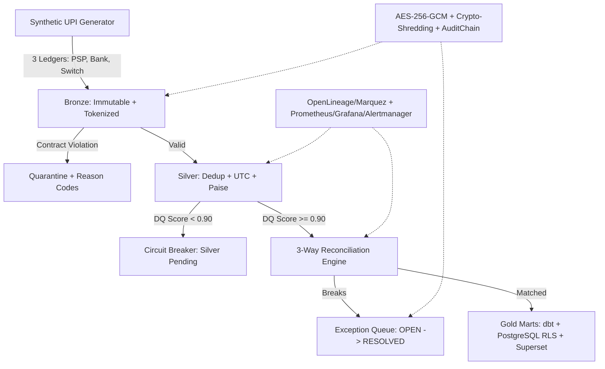

# ReconLake

> **A reconciliation-first, security-by-design UPI-style transaction lakehouse — built entirely with free, open-source tools.**

[](LICENSE)
[](https://www.python.org/)
[](#limitations)

---

## Problem Statement

UPI-style instant payments span three independent systems—the **Payment Service Provider (PSP) app**, the **payer bank's Core Banking System (CBS)**, and the **central switch**. Network timeouts, clock skew, retries, and silent drops create reconciliation breaks that carry immediate financial and regulatory exposure.

**ReconLake** treats **three-way reconciliation and security-by-design** as first-class products:
- Proves whether all three ledgers agree on every transaction (`matched + broken + quarantined = total`).
- Enforces versioned YAML data contracts with CI breaking-change gates and quarantine reason codes.
- Protects restricted PII with Bronze-boundary HMAC tokenization, per-token AES-256-GCM envelope encryption, crypto-shredding, hash-chained audit logs, and PostgreSQL Row-Level Security.

---

## Architecture



---

## Quickstart (5 Commands or Fewer)

```bash
git clone <your-repo-url> reconlake && cd reconlake
make generate-secrets
make up PROFILE=core
make demo
```

Or run the full end-to-end Python demo & test suite locally without Docker:

```bash
python -m pip install -e ".[dev,test,security]"
python scripts/demo.py --count 10000
pytest tests/ -v
```

---

## Measured Results

| Metric | Measured Result | Source |
|---|---|---|
| **Test Suite** | 25/25 passing (unit, integration, Hypothesis property, chaos), 88.33% coverage | `pytest tests/ -v` |
| **Static & Security Lint** | `ruff` clean, `mypy` clean (33 files), `bandit` 0 Medium/High issues | `make lint typecheck` |
| **10k Txns E2E Demo** | 30,500 events in 11.5s (`2,645.9 events/s`), DQ Score `0.996` | `docs/benchmarks.md` |
| **100k Txns Benchmark** | 304,981 events in 110.0s (`2,772.9 events/s`), `1,206 MB` peak RSS | `docs/benchmarks.md` |
| **Recon Accuracy (100k)** | `AMOUNT_MISMATCH` Precision `1.000` / Recall `0.928`; `MISSING_IN_*` Recall `0.955–0.972` | `docs/recon-results.md` |

---

## Security Summary

- **100% synthetic data only**: Never connects to or ingests real payment data or PII.
- **No MinIO / no paid tools**: Uses **SeaweedFS** (Apache 2.0) and **OpenBao** (with `LocalKeyService` fallback).
- **Tokenization & Crypto-Shredding**: Bronze never stores raw VPAs, phones, or accounts; per-token AES-256-GCM DEKs enable DPDP/GDPR erasure (`reconlake-shred`) without rewriting immutable files.
- **Tamper-Evident Audit Chain**: SHA-256 hash-chained log (`reconlake-verify-audit`) + PostgreSQL `REVOKE UPDATE, DELETE, TRUNCATE`.
- **Hardened Containers & Least Privilege**: Non-root, `cap_drop: ALL`, `no-new-privileges`, segmented Compose networks, TLS via Traefik, 4 PostgreSQL roles (`etl_writer`, `dbt_runner`, `analyst_masked`, `auditor_readonly`), and STRIDE threat model (`docs/security/threat-model.md`).

---

## Limitations

> [!IMPORTANT]
> **ReconLake is a portfolio engineering project built exclusively with synthetic data. It is NOT a certified payments system and is not certified for NPCI, RBI, PCI-DSS, or production banking use.**

- Local Windows/laptop execution uses the documented PyArrow/SQLite fallback path alongside the PySpark/Delta/Docker Compose definitions (`docs/adr/ADR-0008-local-python-fallback-and-laptop-8gb-profiles.md`).
- Docker Compose stacks require Docker Desktop / Linux containers (not run in environments without Docker daemon).

---

## Roadmap

- **v1.0.0** (Current): Full 12-feature core platform (Phases 0–10), 8 ADRs, STRIDE threat model, runbooks, chaos tests, benchmarks.
- **Stretch S1**: Optional hybrid X25519 + ML-KEM-768 key wrapping (`liboqs-python`).
- **Stretch S2**: Point-in-time feature tables + LightGBM fraud scoring API + Evidently drift monitoring.
