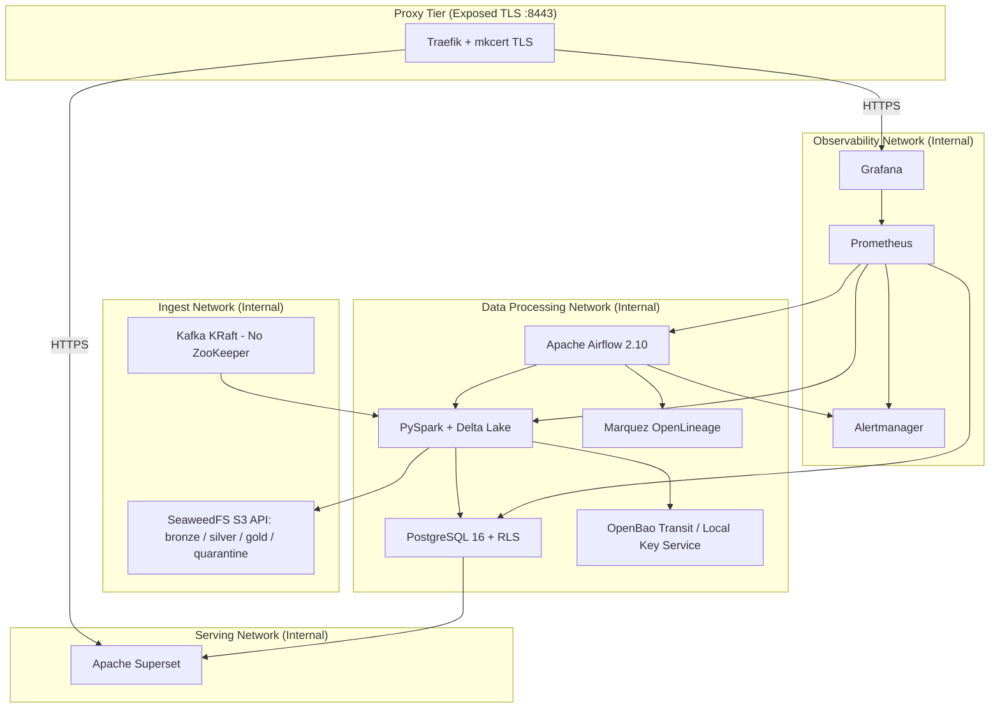

# ReconLake Architecture

## System & Network Segmentation Diagram

ReconLake isolates services across segmented internal Docker networks (`ingest_net`, `data_net`, `serving_net`, `observability_net`). Only Traefik exposes TLS port `8443` on `proxy_net`.

