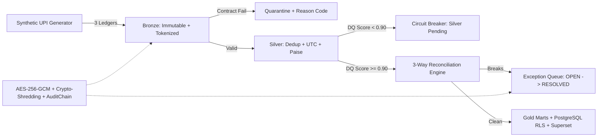

# ReconLake — Engineering Walkthrough & Interview Viva Guide (Phases 0–10)

## Plain-English Architecture Walkthrough

ReconLake solves the core payments data engineering problem: **proving that three independent parties—the PSP app, the payer bank's Core Banking System (CBS), and the central UPI switch—agree on every transaction**, while enforcing strict data contracts, cryptographic privacy erasure, and tamper-evident auditability using only free, open-source tools.

### Data Flow (End-to-End)

## 10 Interview Questions & Model Answers

1. **Why is ReconLake reconciliation-first rather than fraud-first?**
   In retail payments, reconciliation discrepancies (missing legs, amount mismatches, status disagreements) have immediate financial and regulatory liability (T+1 dispute windows). Fraud scoring is downstream of clean, reconciled ledgers.

2. **Why SeaweedFS instead of MinIO?**
   MinIO community edition stopped shipping container images in October 2025 and its repository was archived in April 2026. SeaweedFS provides an Apache 2.0 S3-compatible object store with active maintenance.

3. **How do you satisfy right-to-erasure (DPDP/GDPR) on an immutable Bronze layer?**
   Direct identifiers are HMAC-tokenized at the Bronze boundary, and any recoverable originals are encrypted per token with a unique AES-256-GCM DEK wrapped by a KEK. Deleting the DEK (`reconlake-shred`) permanently renders the ciphertext unreadable everywhere without rewriting immutable Parquet/Delta files.

4. **How do you ensure idempotency across retries and out-of-order backfills?**
   Bronze tracks committed offsets/payload hashes in checkpoints; Silver deduplicates on `(source, event_id)` and upserts via Delta `MERGE` (or keyed Parquet merge); Reconciliation sorts duplicate groups canonically by `(event_id, canonical_json)` so input order never alters outputs.

5. **What does the Data Quality circuit breaker protect against?**
   If completeness, validity, uniqueness, timeliness, or consistency drops the weighted DQ Score below the contract threshold (e.g., `0.90`), the batch is held in `silver_pending/` and Gold promotion is halted while alerting via Prometheus/Alertmanager.

6. **How are data contracts enforced across producers and CI?**
   Each source (`psp`, `payer_bank`, `switch`) has a versioned YAML contract checked at ingestion by `contracts/validator.py` (Pydantic + JSONSchema). In CI, `contracts/compat.py` compares changed contracts against `origin/main` and fails PRs on breaking changes unless accompanied by a major SemVer bump and an ADR.

7. **How does the hash-chained audit log detect tampering?**
   Each `AuditEntry` hashes `{event_type, actor, resource, details, timestamp, prev_hash}` with SHA-256. Modifying any historical entry breaks both its `entry_hash` and the next entry's `prev_hash`. PostgreSQL also revokes `UPDATE`, `DELETE`, and `TRUNCATE` on `audit.audit_log`.

8. **What happens if exact `shared_ref` matching fails in reconciliation?**
   The engine falls back to fuzzy matching on `(payer_vpa_token, payee_vpa_token, amount_paise)` within a configurable time window (`fuzzy_window_seconds`), while still checking for `AMOUNT_MISMATCH`, `STATUS_MISMATCH`, and `TIMING_BREAK`.

9. **How is least privilege enforced in PostgreSQL?**
   Four dedicated roles exist: `etl_writer` (writes `raw_gold.*`), `dbt_runner` (reads `raw_gold.*`, builds `staging`/`gold`), `analyst_masked` (only reads `gold.vw_transactions_masked` with truncated tokens + RLS), and `auditor_readonly` (reads `audit.audit_log` and `recon_breaks` only).

10. **What are the honest limitations of ReconLake?**
    All data is 100% synthetic; it is not NPCI/PCI-DSS certified; the local laptop demo uses a PyArrow/SQLite fallback mode alongside PySpark/Docker Compose configs to fit within 8 GB RAM and run without cloud accounts.
